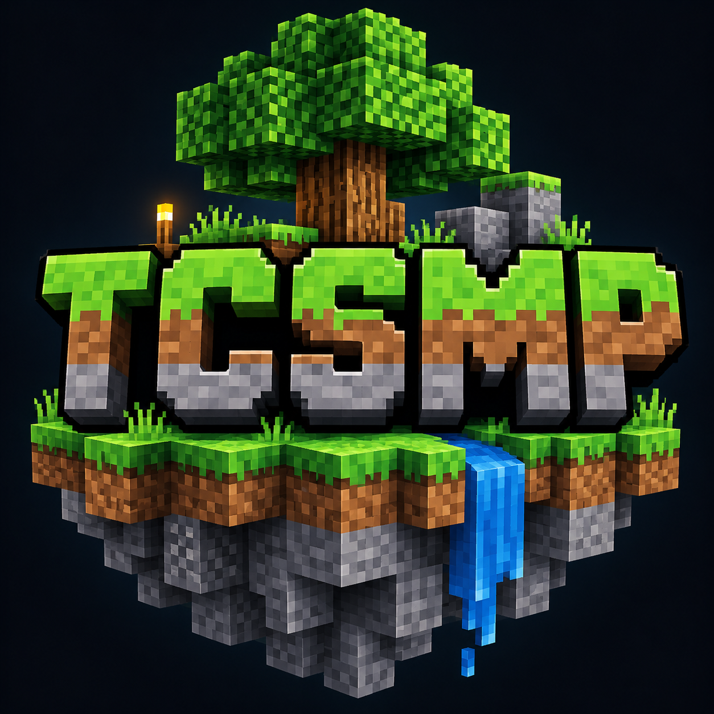

# TruancyCraftPE Server

Native survival multiplayer for **[TruancyCraftPE](https://github.com/Trauncy209/TruancyCraftPE)**. Keeping the soul of old Pocket Edition, with a proper server you can leave running.

**v0.5.25.2 · Terrain streaming fix** · [Download the server](https://github.com/Trauncy209/TruancyCraftPE-Server/releases/download/v0.5.25.2/TruancyCraftPE-Server-0.5.25.2-Linux-x86_64.tar.gz)

This is our headless native server alpha. It runs TCPE worlds directly, without a game window, graphics card, Java server or Java protocol translation. The server is C++ with the original native TCPE/RakNet protocol. It is not a Rust rewrite.

v0.5.25 adds server-owned **rain, snow and thunderstorms**, lightning and weather effects on the world. Weather saves with the world and syncs with matching clients when they join or reconnect. Same native survival, with proper weather.

v0.5.25.2 fixes native terrain changing as you explore. Clients wait for the server's terrain before entering new chunks, and keep the **0.5.25.1** join fixes. Update the client and server together.

## Come play TCSMP

**Address:** `45.41.206.239` · **Port:** `25566` · **Type:** `TCPE`

**Native TruancyCraftPE survival** — Survival, infinite Extreme Terrain with custom world generation, 16 slots, autosaves every minute. Hosted on our homelab through Chicago, with automatic startup after reboots.

Use the matching [TruancyCraftPE v0.5.25.2 client](https://github.com/Trauncy209/TruancyCraftPE/releases/tag/v0.5.25.2). Select **Add Server → Type: TCPE**. This address does not accept Java clients.



## Run your own

On Linux x86_64, install a C++14 compiler, CMake, a build tool and zlib development headers. Then:

```sh
cmake -S . -B build -DCMAKE_BUILD_TYPE=Release
cmake --build build -j1
./build/tcpe-server --name "Native TruancyCraftPE survival" --survival
```

Default port is **25565** for both UDP gameplay and TCP server-list status. Open both protocols. Put a **64×64 PNG** named `server-icon.png` in the working directory for your listing. `--name` supplies the advertised description/MOTD; players can save a separate server label in their list.

Worlds save in `world/` by default. Existing worlds keep their saved seed and game mode: `--survival` selects Survival for a **new** world. Use `--directory`, `--world`, `--port`, `--max-players` and `--autosave` to configure it. Run `--help` for all options. Console commands: `save`, `list`, `stop`, `help`, `/op username`, `/deop username`. Use `--console /path/to/console.in` for an owner-only FIFO console with a background service. SIGTERM saves cleanly.

## Server-owned settings

TCSMP uses a Survival world. Players are sent the server's game mode when joining. World administration is default-deny. Only the local server console can run `/op username` or `/deop username`; chat can never grant operators. Grants are saved in `operators.txt`. Operators can use `/time set day|night|NUMBER`, `/gamerule keepInventory|doDaylightCycle true|false` and `/weather clear|rain|thunder [seconds]`. Weather duration is 1–50000 seconds; leaving it out uses 300 seconds. Creative and give commands remain disabled, including for operators. Incoming client StartGame, SetTime and AdventureSettings packets have no server mutation handlers. Normal world time continues naturally.

The matching client source also blocks the local game-mode toggle on remote worlds and hides game-mode, keep-inventory and tick-speed controls there. Those changes require a newly built client; they cannot retrofit installed APKs.

Native usernames are unauthenticated. An operator name can be impersonated; keep the operator list empty on public deployments until authenticated operator identity is implemented. TCSMP currently has no operators.

This is an alpha built on a legacy, partly client-trusting protocol. Inventory/equipment and other gameplay packets still need a broader authority/security audit. This is not a claim of cheat resistance or production hardening. There is no Paper/PocketMine plugin loader or plugin API yet.

## What we checked

Native login, world spawn, chunk download, multiple clients, movement/chat, block replication, autosave, graceful shutdown/restart and saved-world reload. TCSMP's public Chicago address passed TCP status/icon, UDP discovery, login and chunk download. Weather checks cover state/save reload, two-client synchronization, reconnects and operator command permissions. The matching arm64 client also received user weather testing on a phone; longer sessions and wider device testing are still ongoing.

[Dedicated server details](docs/native-dedicated-server.md) · [Client project](https://github.com/Trauncy209/TruancyCraftPE) · [Discord](https://discord.gg/zeuspvp)

Original source copyright and RakNet notices are retained; see [source notices](SOURCE-NOTICES.txt). This repository adds no new blanket license over inherited code and includes no game textures or audio. The TCSMP logo was generated with imagegen for this server.
